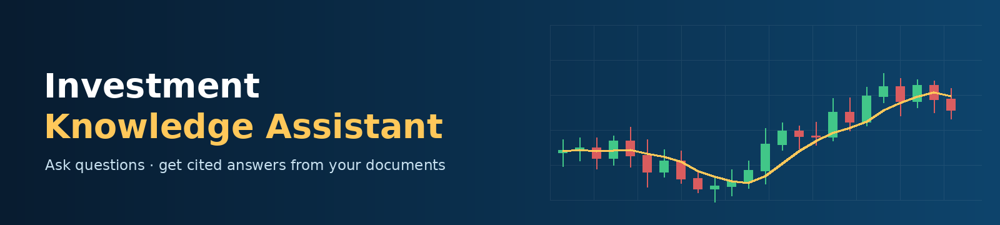
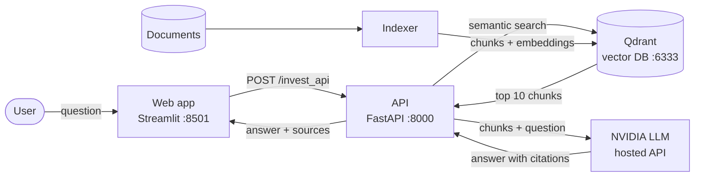

# Investment Knowledge App – RAG with Generative AI

Ask questions about investment documents (stock market, Nasdaq, investment strategies) and get answers written by an LLM, with **citations to the exact documents** they came from.

The app uses **RAG (Retrieval-Augmented Generation)**: it first finds the most relevant passages in your documents, then asks the LLM to answer using only those passages.

## How it works



1. **Indexing** – `investment_rag.py` reads every PDF, Word (.docx), PowerPoint (.pptx) and text file in `Documents/` (including subfolders), splits the text into ~500-token chunks (50 overlap), turns each chunk into a 768-dimension vector, and stores it in Qdrant.
2. **Search** – when a question arrives, the API embeds it with the same model and retrieves the 10 most similar chunks.
3. **Answer** – the chunks, labelled `[0]`…`[9]`, are sent with the question to the LLM, which is instructed to answer only from them, cite the labels, and say it doesn't know when the answer isn't there.
4. **Display** – the web app shows the answer and, for each cited document, the chunk text and a button to download the original file.

## Tech stack

| Component | Technology |
| --- | --- |
| Web app | Streamlit |
| API | FastAPI + Uvicorn |
| Vector database | Qdrant |
| Embeddings | `sentence-transformers/msmarco-bert-base-dot-v5` (runs locally, CPU) |
| LLM | `nvidia/nemotron-3.5-lightning-30b-a3b` via the NVIDIA API (OpenAI-compatible client) |
| Orchestration | LangChain (text splitting, Qdrant + Hugging Face integrations) |
| Packaging | Docker + Docker Compose |

## Project structure

```
.
├── Documents/                 # Source documents to index (PDF, DOCX, PPTX, TXT)
├── assets/
│   └── banner.png             # Banner shown in the web app
├── investment_rag.py          # Indexing: reads, chunks, embeds and stores documents in Qdrant
├── investment_api.py          # FastAPI app: search + LLM call (POST /invest_api)
├── investment_start_api.py    # Starts the API with Uvicorn
├── investment_web_app.py      # Streamlit front end
├── investment_env_var.py      # Reads NVIDIA_API_KEY from the environment
├── index_entrypoint.py        # Docker: waits for Qdrant, then runs the indexing
├── Dockerfile                 # Builds the application image
├── docker-compose.yml         # Builds and runs all services (development)
├── docker-compose.share.yml   # Runs a prebuilt image (no source code needed)
├── .env.example               # Template for the NVIDIA API key
├── .dockerignore
└── requirements.txt
```

## Prerequisites

- An **NVIDIA API key** (free): sign in at [build.nvidia.com](https://build.nvidia.com), open any model page and click **Get API Key**.
- **Option A (Docker):** Docker Desktop.
- **Option B (local):** Python 3.12 and Docker (for Qdrant only).

## Configuration

Create a `.env` file in the project root from the template and add your key:

```bash
cp .env.example .env          # Windows PowerShell: Copy-Item .env.example .env
```

```
NVIDIA_API_KEY=nvapi-your-key
```

`.env` is ignored by Git and Docker, so the key never ends up in the repository or the image.

| Variable | Used by | Default |
| --- | --- | --- |
| `NVIDIA_API_KEY` | API | *(empty: the app runs but cannot generate answers)* |
| `QDRANT_URL` | API, indexer | `http://localhost:6333` |
| `API_URL` | Web app | `http://127.0.0.1:8000/invest_api` |

## Option A – Run with Docker Compose (recommended)

```bash
docker compose up --build
```

This builds one image and starts four services in order:

1. **qdrant** – the vector database
2. **indexer** – indexes `Documents/`, then exits
3. **api** – starts once indexing has succeeded
4. **web** – the Streamlit app

Then open:

| Service | URL |
| --- | --- |
| Web app | http://localhost:8501 |
| API docs | http://localhost:8000/docs |
| Qdrant dashboard | http://localhost:6333/dashboard |

Stop with `Ctrl+C`, then `docker compose down` (add `-v` to also delete the index).

### Sharing a prebuilt image

```bash
docker save -o investment-rag.tar investment-rag:1.0
```

The recipient needs only `investment-rag.tar`, `docker-compose.share.yml` and their own `.env`:

```bash
docker load -i investment-rag.tar
docker compose -f docker-compose.share.yml up
```

## Option B – Run locally with Python

```bash
# 1. Create and activate a virtual environment (Python 3.12)
python -m venv investenv
source investenv/bin/activate            # Windows PowerShell: .\investenv\Scripts\Activate.ps1

# 2. Install dependencies
pip install -r requirements.txt

# 3. Start Qdrant
docker run --name vectordb -d -p 6333:6333 qdrant/qdrant

# 4. Index the documents
python investment_rag.py Documents

# 5. Start the API (keep this terminal open)
export NVIDIA_API_KEY=nvapi-your-key     # Windows PowerShell: $env:NVIDIA_API_KEY="nvapi-your-key"
python investment_start_api.py

# 6. In a second terminal (with the environment activated), start the web app
streamlit run investment_web_app.py
```

> On Windows, if activation fails with "running scripts is disabled", run `Set-ExecutionPolicy -Scope CurrentUser RemoteSigned` once.

## Example questions

- What is the best investment strategy for retirement?
- How does buying stocks directly on the Nasdaq work?
- What is the NASDAQ-100?

## API

`POST /invest_api`

```json
{ "query": "What is the NASDAQ-100?" }
```

Response:

```json
{
  "context": [
    { "id": 0, "path": "Documents/Nasdaq.docx", "content": "..." }
  ],
  "answer": "The NASDAQ-100 is an index of the 100 largest non-financial companies listed on Nasdaq [0]."
}
```

## Notes and limitations

- **English documents and questions work best:** the embedding model is English-only.
- **Answers are grounded in the indexed documents only**; always check the cited sources for important decisions. This project is for learning and is not financial advice.
- The same embedding model, normalization and distance (`DOT`, 768 dimensions) must be used for indexing and querying. Changing the model requires re-indexing.
- NVIDIA's free endpoints are rate-limited and models are occasionally retired; the model name is set in `investment_api.py`.
- Each Docker start re-indexes `Documents/` from scratch.

## Acknowledgements

Based on a project from the Data Science Academy (DSA) Generative AI course, extended with Docker Compose packaging, environment-based configuration and an updated LLM.
